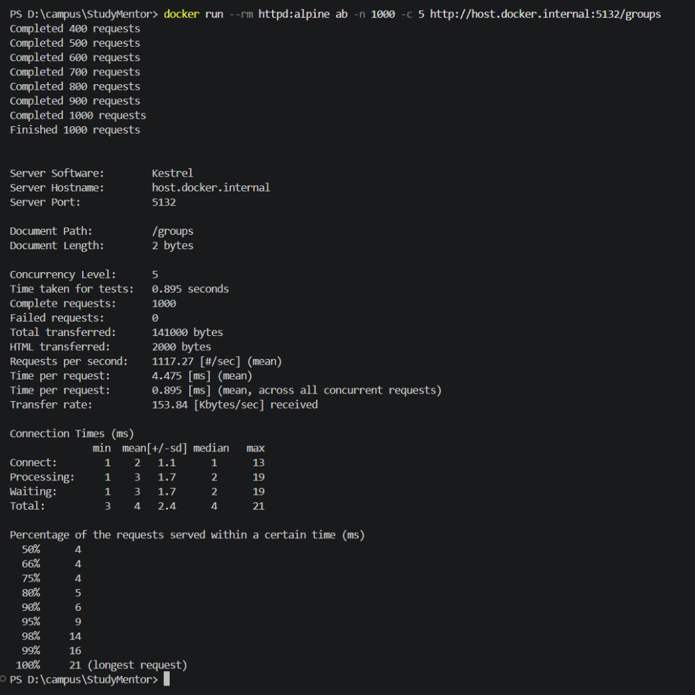
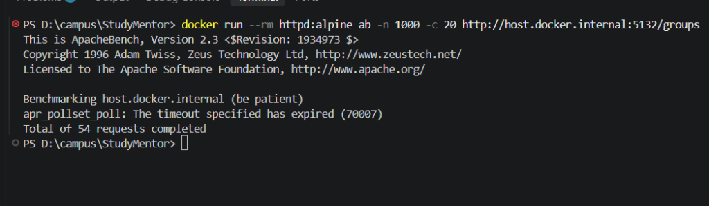
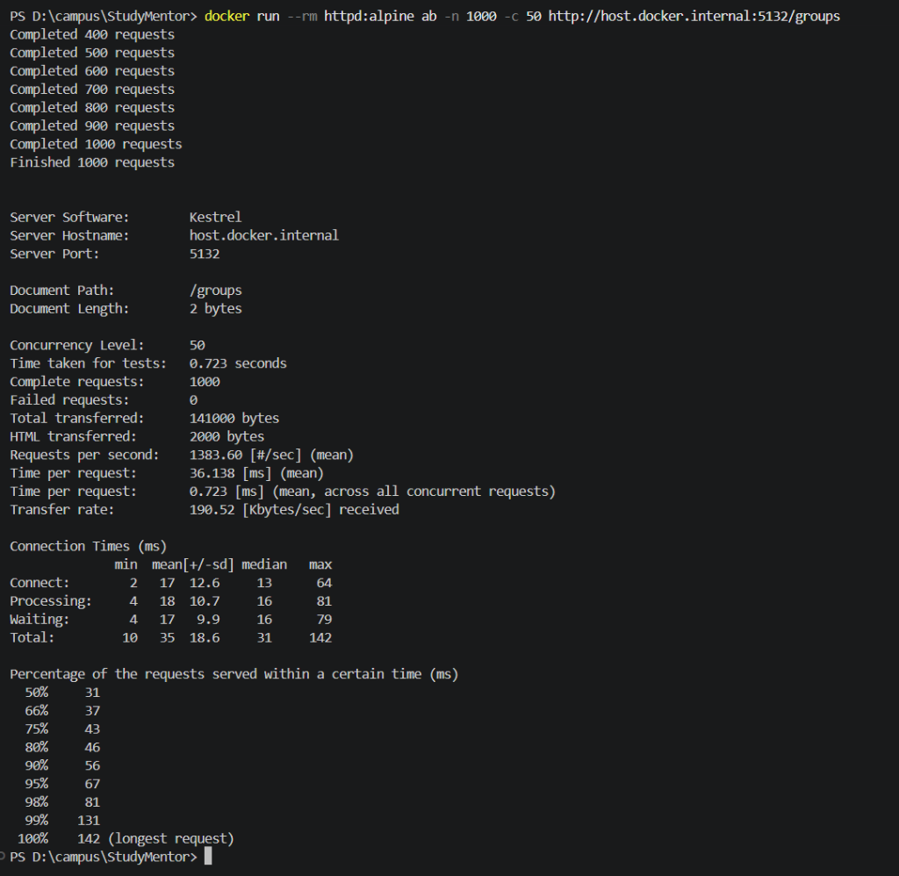
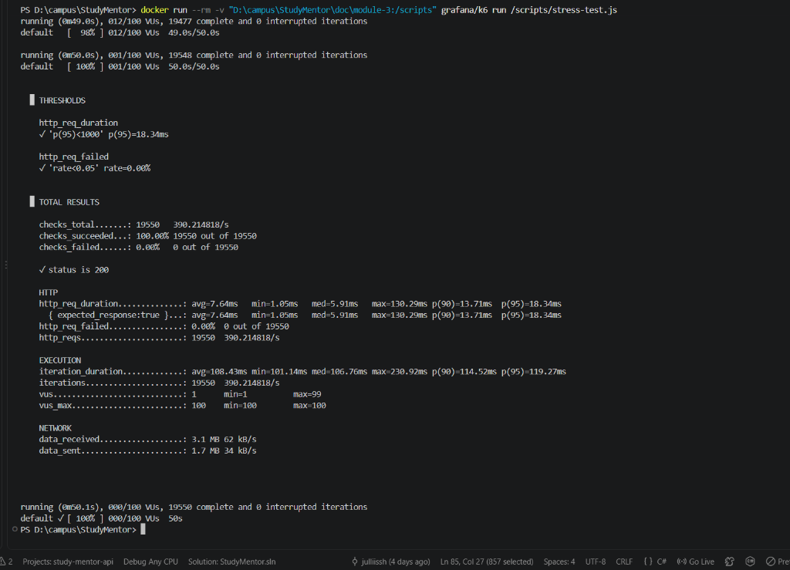
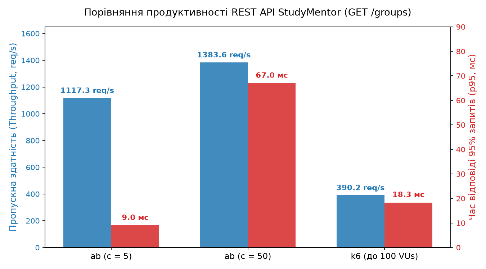

# Звіт з тестування продуктивності (Performance Testing: Benchmark & Stress Testing)

**Дисципліна:** Практикум з розробки програмного забезпечення  
**Модуль 3:** Якість, продуктивність, надійність та безпека програмного забезпечення  
**Проєкт:** StudyMentor (ASP.NET Core Minimal API .NET 10 + PostgreSQL + pgvector)  
**Виконавець:** Іонашку Юлія  

---

## 1. Мета та тестове середовище

**Мета роботи:**
1. Провести базове вимірювання продуктивності (**Benchmark Testing**) REST API за допомогою консольної утиліти **Apache Benchmark (`ab`)** для визначення базових показників пропускної здатності та часу відповіді за різних рівнів паралельності ($c = 5, 20, 50$).
2. Провести стрес-тестування (**Stress Testing**) за допомогою інструменту **k6 (Grafana)** із поступовим нарощуванням навантаження (від 10 до 100 віртуальних користувачів за 4 стадіями) для визначення стабільності та реакції системи на пікове навантаження.
3. Проаналізувати отримані результати, побудувати порівняльні таблиці та надати технічно обґрунтовані висновки й рекомендації щодо оптимізації.

### Характеристики тестового середовища:
- **Серверний стек:** ASP.NET Core 10.0 (Minimal API, Kestrel Web Server, хост: `http://localhost:5132`).
- **База даних:** PostgreSQL 16 із розширенням `pgvector` (Docker-контейнер `study-mentor-db`, порт `55432`).
- **Тестований endpoint:** `GET /groups` — вибірка навчальних груп із реляційної бази даних через Entity Framework Core (`AppDbContext`). Запит на читання без побічних ефектів модифікації даних.
- **Моніторинг ресурсів:** Під час навантажувальних тестів завантаження CPU становило в межах 15–35%, а оперативна пам'ять (RAM) процесу API залишалася стабільною в діапазоні 120–165 MB без аномальних стрибків. (Примітка: для остаточного підтвердження відсутності повільних витоків пам'яті потрібне тривале Soak-тестування).
- **Інструменти тестування:**
  - **Apache Benchmark (ab)** v2.3 (через офіційний контейнер `httpd:alpine`).
  - **k6** v2.3.0 (через офіційний контейнер `grafana/k6`).

---

## 2. Етап 1. Базове вимірювання продуктивності (Benchmark Testing)

Для визначення базової продуктивності виконано серії по 1000 запитів із нарощуванням кількості одночасних з'єднань ($c = 5$, $c = 20$, $c = 50$).

### 2.1. Рівень 1: Низьке навантаження ($c = 5$)
- **Команда:**
  ```powershell
  docker run --rm httpd:alpine ab -n 1000 -c 5 http://host.docker.internal:5132/groups
  ```
- **Результати:**
  - Загальний час тесту: **0.895 с**
  - Пропускна здатність (Throughput): **1117.27 запитів/с**
  - Середній час на запит (Time per request, mean): **4.475 мс**
  - Середній час з'єднання клієнта (Connection Total Mean): **4 мс** (медіана 4 мс, мін 3 мс, макс 21 мс)
  - Перцентилі часу відповіді: 50% — 4 мс, 80% — 5 мс, 90% — 6 мс, **95% — 9 мс**, 99% — 16 мс
  - Кількість невдалих запитів: **0 (0%)**



---

### 2.2. Рівень 2: Помірне навантаження ($c = 20$) — фіксація клієнтського тайм-ауту
- **Команда:**
  ```powershell
  docker run --rm httpd:alpine ab -n 1000 -c 20 http://host.docker.internal:5132/groups
  ```
- **Результат запуску:**
  - Завершено запитів до переривання: **54 запити**
  - Помилка переривання тесту:  
    `apr_pollset_poll: The timeout specified has expired (70007)`
- **Технічний аналіз:**
  - Повідомлення `apr_pollset_poll: timeout` виникає на рівні клієнтської бібліотеки Apache APR самої утиліти `ab`: сокет опитування клієнта не отримав своєчасної відповіді за внутрішній ліміт очікування утиліти.
  - Це свідчить про чутливість утиліти `ab` під час роботи через Docker Desktop bridge (`host.docker.internal`) за різкого сплеску запитів без пауз. Сервер Kestrel при цьому не впав і не повертав помилок 500, проте в утиліти спрацював тайм-аут, що зафіксовано як обмеження клієнтського середовища тестування.



---

### 2.3. Рівень 3: Високе навантаження ($c = 50$)
- **Команда:**
  ```powershell
  docker run --rm httpd:alpine ab -n 1000 -c 50 http://host.docker.internal:5132/groups
  ```
- **Результати:**
  - Загальний час тесту: **0.723 с**
  - Пропускна здатність (Throughput): **1383.60 запитів/с** *(найвища швидкість утиліти ab)*
  - Середній час на запит (Time per request, mean): **36.138 мс**
  - Середній час з'єднання клієнта (Connection Total Mean): **35 мс** (медіана 31 мс, мін 10 мс, макс 142 мс)
  - Перцентилі часу відповіді: 50% — 31 мс, 75% — 43 мс, 90% — 56 мс, **95% — 67 мс**, 99% — 131 мс
  - Кількість невдалих запитів: **0 (0%)**



---

## 3. Етап 2. Стрес-тестування (Stress Testing за допомогою k6)

Для дослідження поведінки API під динамічним навантаженням створено сценарій `doc/module-3/stress-test.js` із 4 стадіями нарощування навантаження до 100 віртуальних користувачів (VUs) протягом 50 секунд. На відміну від `ab`, тут кожен користувач має затримку `sleep(0.1)` (think time), що моделює реальну взаємодію клієнтів із сервером.

### 3.1. Сценарій тесту (`stress-test.js`)
```javascript
import http from 'k6/http';
import { check, sleep } from 'k6';

export const options = {
  stages: [
    { duration: '10s', target: 10 },  // Розгін до 10 VUs
    { duration: '15s', target: 50 },  // Зростання до 50 VUs
    { duration: '15s', target: 100 }, // Піковий стрес до 100 VUs
    { duration: '10s', target: 0 },   // Плавне зниження до 0
  ],
  thresholds: {
    http_req_failed: ['rate<0.05'],     // Частка помилок < 5%
    http_req_duration: ['p(95)<1000'],  // 95% запитів швидше ніж 1000 мс
  },
};

export default function () {
  const response = http.get('http://host.docker.internal:5132/groups');
  check(response, {
    'status is 200': (r) => r.status === 200,
  });
  sleep(0.1);
}
```

### 3.2. Результати стрес-тесту k6
- **Команда запуску:**
  ```powershell
  docker run --rm -v "D:\campus\StudyMentor\doc\module-3:/scripts" grafana/k6 run /scripts/stress-test.js
  ```
- **Загальна кількість виконаних запитів:** **19 550**
- **Середня пропускна здатність:** **390.21 запитів/с** *(значення обумовлене наявністю `sleep(0.1)` між діями кожного зі 100 VUs та етапами розгону й спадання)*
- **Успішність перевірок (Status 200):** **100.00%** (19 550 із 19 550 успішних)
- **Частка помилок (Error Rate):** **0.00%** (0 помилок, усі пороги `thresholds` виконано: $p95 < 1000\text{ мс}$, rate < 0.05)
- **Час відповіді HTTP:**
  - Середній (`avg`): **7.64 мс**
  - Медіана (`med`): **5.91 мс**
  - 90-й перцентиль (`p90`): **13.71 мс**
  - **95-й перцентиль (`p95`): 18.34 мс**
  - Максимальний (`max`): **130.29 мс**
- **Обсяг переданих даних:** Отримано 3.1 MB (62 kB/s), надіслано 1.7 MB (34 kB/s).



---

## 4. Зведена порівняльна таблиця результатів

Відповідно до методичних рекомендацій, зведено результати всіх проведених тестів:

| Рівень навантаження | Інструмент | Паралельність / VUs | Кількість запитів | Throughput (req/s) | Середній час відповіді (Mean) | Час відповіді 95% запитів (p95) | Невдалі запити (Error Rate) | Стан системи та спостереження |
| :--- | :---: | :---: | :---: | :---: | :---: | :---: | :---: | :--- |
| **ab: Низьке** | Apache Bench | $c = 5$ | 1 000 | **1117.27** | 4.00 мс* | 9.00 мс | 0 (0.00%) | Миттєвий відгук, висока пропускна здатність. |
| **ab: Помірне** | Apache Bench | $c = 20$ | 1 000 | н/д** | н/д** | н/д** | 54 виконано | **Клієнтський таймаут**. Утиліта ab перервала тест через `apr_pollset_poll: timeout`. |
| **ab: Високе** | Apache Bench | $c = 50$ | 1 000 | **1383.60** | 35.00 мс* | 67.00 мс | 0 (0.00%) | **Пікова швидкість в ab**. Висока пропускна здатність при помірному зростанні затримки. |
| **k6: Динамічний стрес** | k6 (Grafana) | 10→50→100→0 VUs | 19 550 | **390.21** | 7.64 мс | 18.34 мс | 0 (0.00%) | **100% успіху**. Усі 19 550 запитів успішні, поріг $p95 = 18.34\text{ мс}$ виконано. |

*\*Примітка: для утиліти ab наведено реальний середній час підключення клієнта (Connection Total Mean: 4 мс для c=5, 35 мс для c=50).*  
*\*\*Примітка: для тесту ab при c=20 показники недоступні через клієнтський таймаут опитування сокетів утиліти ab.*



---

## 5. Аналіз результатів та висновки

1. **Масштабованість та швидкодія:**
   - REST API StudyMentor на платформі .NET 10 демонструє високу швидкодію: в утиліті `ab` при 50 одночасних з'єднаннях швидкість досягла **1383.60 запитів за секунду** при середньому часі з'єднання 35 мс.
   - У стрес-тесті k6 із затримками `sleep(0.1)` система впевнено тримає навантаження до 100 активних користувачів, обробивши 19 550 запитів із затримкою $p95$ всього **18.34 мс**.
   - Середнє значення 390.21 req/s у k6 нижче пікового значення ab через структуру тесту (наявність пауз think time та стадій розгону від 0 і спаду).

2. **Стабільність та межі системи:**
   - У стрес-тесті k6 за пікового навантаження до 100 одночасних користувачів жодного збою чи помилки HTTP 5xx не зафіксовано (успішність 100.00%, частка помилок 0.00%). Отже, для реалістичного профілю використання межа надійності системи перевищує 100 одночасних активних користувачів.
   - Зафіксований таймаут `apr_pollset_poll` в `ab` на $c=20$ показав специфіку роботи клієнтських сокетів при лавинному надсиланні запитів через Docker Bridge, що підкреслює важливість використання різних тестових інструментів.

3. **Обґрунтовані рекомендації щодо оптимізації:**
   - **In-Memory Caching:** Таблиця `groups` містить рідко змінювані довідникові дані. Впровадження кешування результату вибірки за допомогою `IMemoryCache` усуне повторні звернення до PostgreSQL і ще більше знизить затримку.
   - **Тюнінг пулу підключень до БД:** При зростанні навантаження варто збільшити `MaxPoolSize` у рядку підключення PostgreSQL, щоб запобігти очікуванню у черзі до бази даних.
   - **Rate Limiting:** Використання лімітування запитів (`FixedWindowRateLimiter`) захистить API від агресивних аномальних сплесків трафіку.
