# Звіт із тестування продуктивності (Performance Testing: Benchmark & Stress Testing)

**Дисципліна:** Практикум з розробки програмного забезпечення  
**Модуль 3:** Якість, продуктивність, надійність та безпека програмного забезпечення  
**Пакет 3:** Продуктивність та БД  
**Виконавець:** Федюк Владислав  

---

## 1. Мета роботи та конфігурація тестового середовища

**Мета тестування:**
1. Визначити базові показники продуктивності (**Benchmark Testing**) REST API `StudyMentor` за допомогою консольної утиліти **Apache Benchmark (`ab`)** за різних рівнів одночасних запитів ($c = 5, 20, 50, 100$).
2. Провести стрес-тестування (**Stress Testing**) та пікове тестування (**Spike Testing**) за допомогою **Grafana k6** для визначення межі стабільної роботи системи, динаміки деградації часу відповіді ($p_{95}$) та поведінки сервера за навантаження до 300 віртуальних користувачів (VU).
3. Сформувати гіпотези щодо вузьких місць архітектури для подальшої верифікації під час профілювання (`Profiling`) та оптимізації запитів до бази даних (`Database Optimization`).

### Параметри середовища та умови вимірювання:
- **Сервер застосунку:** ASP.NET Core 10.0 Minimal API (`Kestrel`), запущений у конфігурації **Release** (`dotnet run -c Release --project study-mentor-api --launch-profile http`, адреса `http://localhost:5132`).
- **Конфігурація ізоляції:** `RateLimiting__Enabled=false`, `Caching__Enabled=false` (базові виміри знято до ввімкнення кешування та рефакторингу).
- **СУБД:** PostgreSQL 16 (`pgvector/pgvector:pg16` у Docker-контейнері `study-mentor-db`, порт `55432`).
- **Обсяг тестових даних ([`seed.sql`](benchmark/seed.sql)):**
  - `majors`: **20** записів;
  - `subjects`: **200** записів;
  - `lectures`: **5 000** записів;
  - `users`: **50 000** записів (`50` груп);
  - `exercises` (`Flashcard`): **200** наборів;
  - `exercises` (`Test`): **2 000** тестів, **6 000** питань (`test_questions`), **24 000** варіантів відповідей (`test_answer_variants`).
- **Тестовані endpoint-и (без побічних ефектів модифікації даних):**
  1. `GET /lectures` — основний endpoint: повертає список із 5 000 лекцій разом із вкладеними об'єктами `SubjectResponse` та `MajorResponse` (розмір JSON-відповіді — **1 748 317 байтів ≈ 1.75 МБ**).
  2. `GET /tests?sourceFlashcardId=58cbc2f9-f0ab-024e-2005-4cb619d7d242` — додатковий endpoint: повертає тести, згенеровані на основі конкретного набору карток (10 тестів із 2 000, розмір JSON-відповіді — **23 909 байтів**).
- **Інструменти:**
  - **Apache Benchmark (`ab`)** v2.3 (Revision 1934973, Apache Lounge Win64) — по 3 прогони після прогріву (warm-up) для кожного рівня паралельності, у звіт взято **медіанний прогін**.
  - **Grafana k6** v0.54.0 (`windows/amd64`) — сценарії [`stress-test.js`](benchmark/stress-test.js) та [`spike-test.js`](benchmark/spike-test.js).
  - **Моніторинг ресурсів:** оскільки ні `ab`, ні `k6` штатно не збирають метрики процесора й пам'яті серверного процесу ОС, показники CPU (%) та RAM (`WorkingSet64`, МБ) процесу `study-mentor-api` паралельно фіксувалися через системний моніторинг (`Get-Process` та `dotnet-counters`).

---

## 2. Етап 1. Базове вимірювання продуктивності (Benchmark Testing — Apache Benchmark)

### 2.1. Тестування основного endpoint-а `GET /lectures` ($n = 1000$)

Виконано серії по $n = 1000$ запитів при рівнях паралельності $c = 5, 20, 50, 100$ (по 3 прогони на кожному рівні).

#### Рівень 1: $c = 5$ (`ab -n 1000 -c 5 http://localhost:5132/lectures`)
- **Пропускна здатність (Throughput):** `40.55 req/s` (медіана з 3 прогонів: `47.26`, `40.55`, `39.90 req/s`)
- **Середній час відповіді (`Time per request, mean`):** `123.32 мс` (`24.66 мс` у розрахунку на всі паралельні запити)
- **Перцентилі часу відповіді:** $p_{50} = 117\text{ мс}$, $p_{90} = 174\text{ мс}$, **$p_{95} = 192\text{ мс}$**, $p_{99} = 240\text{ мс}$, $\max = 319\text{ мс}$
- **Кількість невдалих запитів:** `0 (0%)`
- **Швидкість передавання даних:** `69 224.22 KB/sec` (~67.6 МБ/с)


#### Рівень 2: $c = 20$ (`ab -n 1000 -c 20 http://localhost:5132/lectures`)
- **Пропускна здатність (Throughput):** `47.78 req/s` (прогони: `47.78`, `45.13`, `47.84 req/s`)
- **Середній час відповіді (`Time per request, mean`):** `418.55 мс` (`20.93 мс` across all concurrent)
- **Перцентилі часу відповіді:** $p_{50} = 407\text{ мс}$, $p_{90} = 501\text{ мс}$, **$p_{95} = 540\text{ мс}$**, $p_{99} = 616\text{ мс}$, $\max = 661\text{ мс}$
- **Кількість невдалих запитів:** `0 (0%)`
- **Спостереження:** Пропускна здатність зросла лише на 17.8% (з `40.55` до `47.78 req/s`), тоді як середній час очікування клієнта зріс у **3.4 раза**, а $p_{95}$ перетнув умовний поріг `500 мс`.

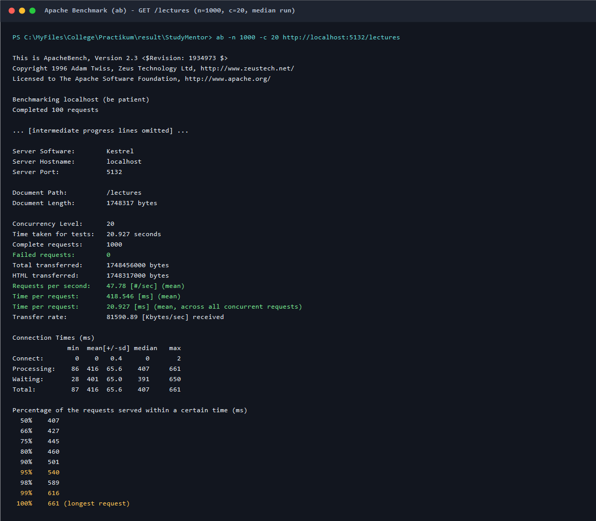

#### Рівень 3: $c = 50$ (`ab -n 1000 -c 50 http://localhost:5132/lectures`)
- **Пропускна здатність (Throughput):** `53.98 req/s` (прогони: `46.85`, `55.10`, `53.98 req/s`)
- **Середній час відповіді (`Time per request, mean`):** `926.33 мс` (`18.53 мс` across all concurrent)
- **Перцентилі часу відповіді:** $p_{50} = 892\text{ мс}$, $p_{90} = 1126\text{ мс}$, **$p_{95} = 1169\text{ мс}$**, $p_{99} = 1267\text{ мс}$, $\max = 1437\text{ мс}$
- **Кількість невдалих запитів:** `0 (0%)`
- **Спостереження:** Час відповіді перевищив 1 секунду ($p_{95} = 1.17\text{ с}$), а споживання оперативної пам'яті процесом API зросло з `345.8 МБ` до **`620.6 МБ`** через одночасну матеріалізацію та відстеження (Change Tracking) по 5 220 сутностей у 50 паралельних запитах.

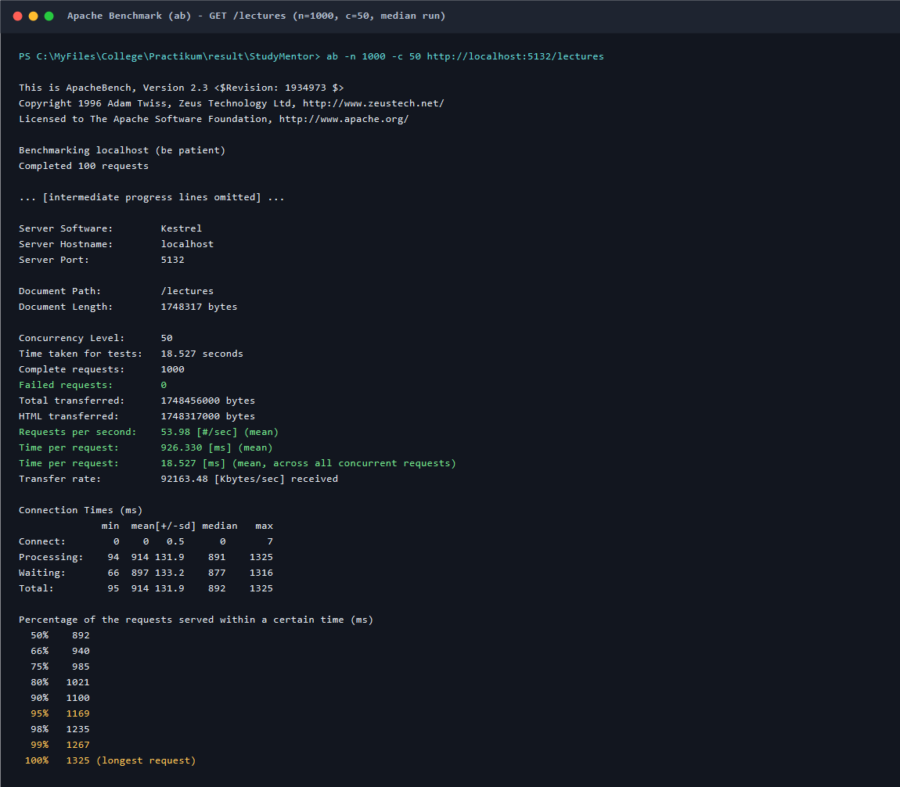

#### Рівень 4: $c = 100$ (`ab -n 1000 -c 100 http://localhost:5132/lectures`)
- **Пропускна здатність (Throughput):** `58.49 req/s` (прогони: `58.78`, `57.46`, `58.49 req/s`)
- **Середній час відповіді (`Time per request, mean`):** `1709.83 мс` (`17.10 мс` across all concurrent)
- **Перцентилі часу відповіді:** $p_{50} = 1692\text{ мс}$, $p_{90} = 1829\text{ мс}$, **$p_{95} = 1855\text{ мс}$**, $p_{99} = 1904\text{ мс}$, $\max = 1953\text{ мс}$
- **Кількість невдалих запитів:** `0 (0%)`
- **Спостереження:** Пропускна здатність досягла насичення (плато ~`58 req/s`, швидкість передавання `99.85 MB/sec`), а робочий набір пам'яті процесу сягнув **`861.6 МБ`**.

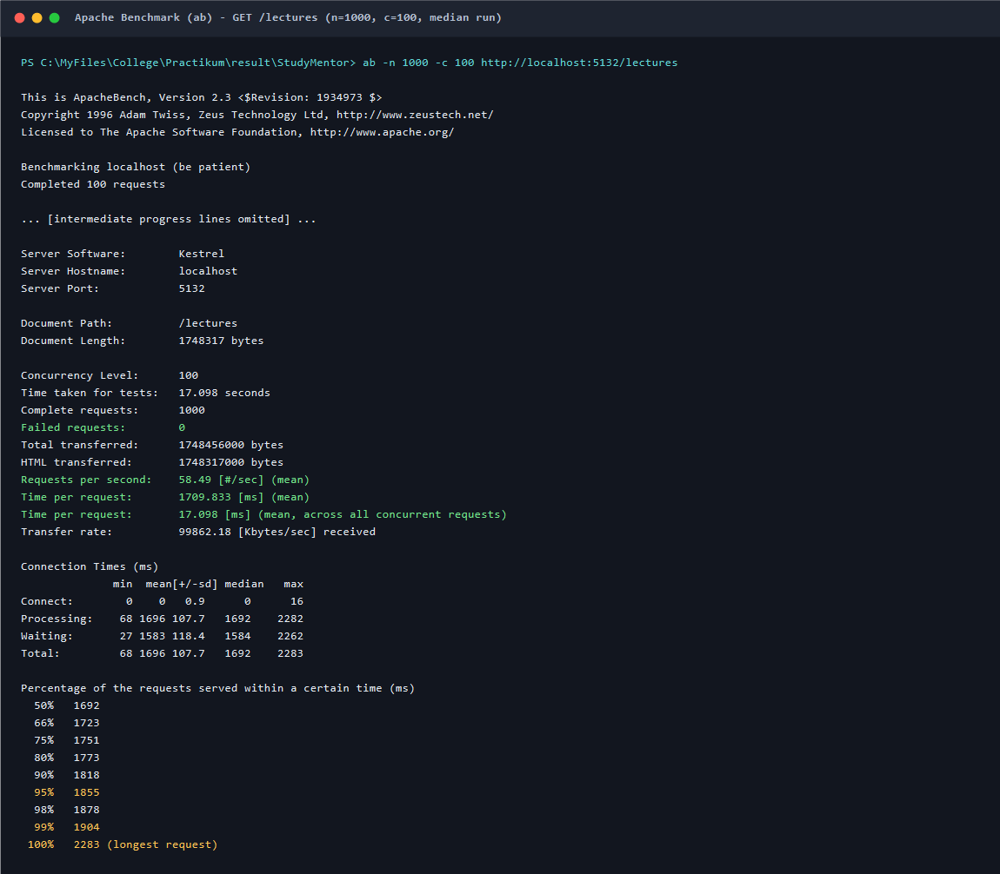

---

### 2.2. Тестування додаткового endpoint-а `GET /tests?sourceFlashcardId=...` ($n = 200$)

Для перевірки швидкодії вибірки тестів за ідентифікатором картки-джерела виконано заміри `ab` ($n = 200$, $c = 5, 20, 50$):
- При $c = 5$: `5.26 req/s`, середній час `950.01 мс`, $p_{95} = 1122\text{ мс}$, RAM `388.7 МБ`.
- При $c = 20$: `5.17 req/s`, середній час `3869.41 мс`, $p_{95} = 4089\text{ мс}$, RAM `921.2 МБ`.
- При $c = 50$: `5.44 req/s`, середній час `9193.74 мс`, $p_{95} = 10943\text{ мс}$ (~11 с!), RAM `928.7 МБ`.

Навіть при мінімальному паралелізмі ($c = 5$) пропускна здатність становить лише **5.26 req/s**, а час відповіді наближається до 1 секунди, незважаючи на те, що клієнту повертається лише 10 тестів (23.9 КБ). Це вказує на критичну проблему завантаження зайвих даних із БД (in-memory фільтрація всього графа з 2 000 тестів, 6 000 питань і 24 000 варіантів відповідей).

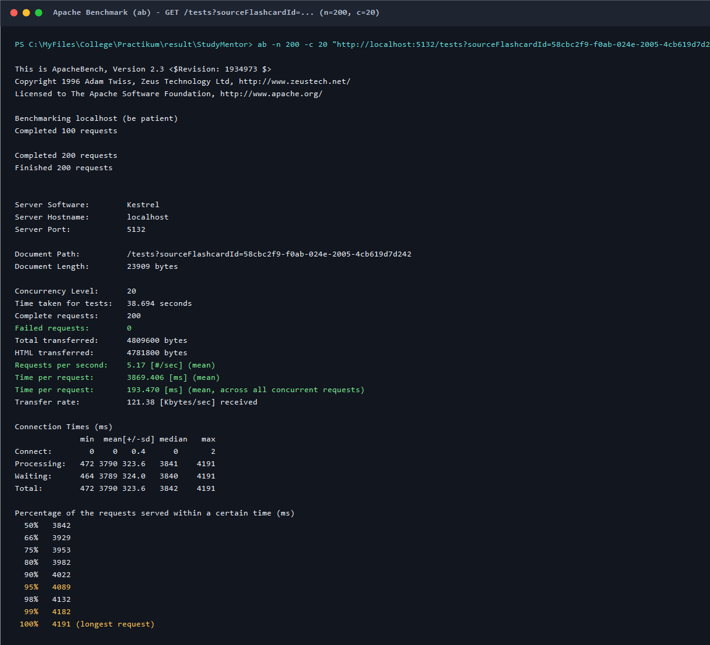

---

## 3. Етап 2. Стрес-тестування та Spike-тестування (Grafana k6)

### 3.1. Сценарій стрес-тестування ([`stress-test.js`](benchmark/stress-test.js))
Використано інструмент **k6** із перевіркою статусу `200 OK`, паузою між ітераціями `sleep(1)` та порогами якості (`thresholds`):
- `http_req_failed: ['rate<0.01']` (частка помилок < 1%);
- `http_req_duration: ['p(95)<500']` (95% запитів швидше ніж 500 мс).

Для точного порівняння показників проведено як **ізольовані 20-секундні прогони** на фіксованих рівнях `10`, `50`, `100`, `200` VU, так і **комплексний ступінчастий прогін** (`10 VU → 50 VU → 100 VU → 200 VU → 0 VU` загальною тривалістю 90 с):
- На рівні **10 VU**: `8.36 req/s`, середній час `158.92 мс`, **$p_{95} = 239.28\text{ мс}$** — поріг `< 500 мс` успішно виконується.
- На рівні **50 VU**: `27.38 req/s`, середній час `747.69 мс`, **$p_{95} = 1026.00\text{ мс}$** — поріг `< 500 мс` порушено більш ніж удвічі.
- На рівні **100 VU**: `38.61 req/s`, середній час `1556.01 мс`, **$p_{95} = 2053.75\text{ мс}$**.
- На рівні **200 VU**: `45.20 req/s`, середній час `3324.68 мс`, **$p_{95} = 3917.13\text{ мс}$**.
- **Комплексний ступінчастий тест (`stages`):** виконано `2 951` запит (передано `5.2 ГБ` даних зі швидкістю `57 МБ/с`), середня пропускна здатність `32.57 req/s`, середній час `1183.32 мс`, медіана `765.10 мс`, **$p_{95} = 3144.66\text{ мс}$**, невдалих запитів `0 (0.00%)`.

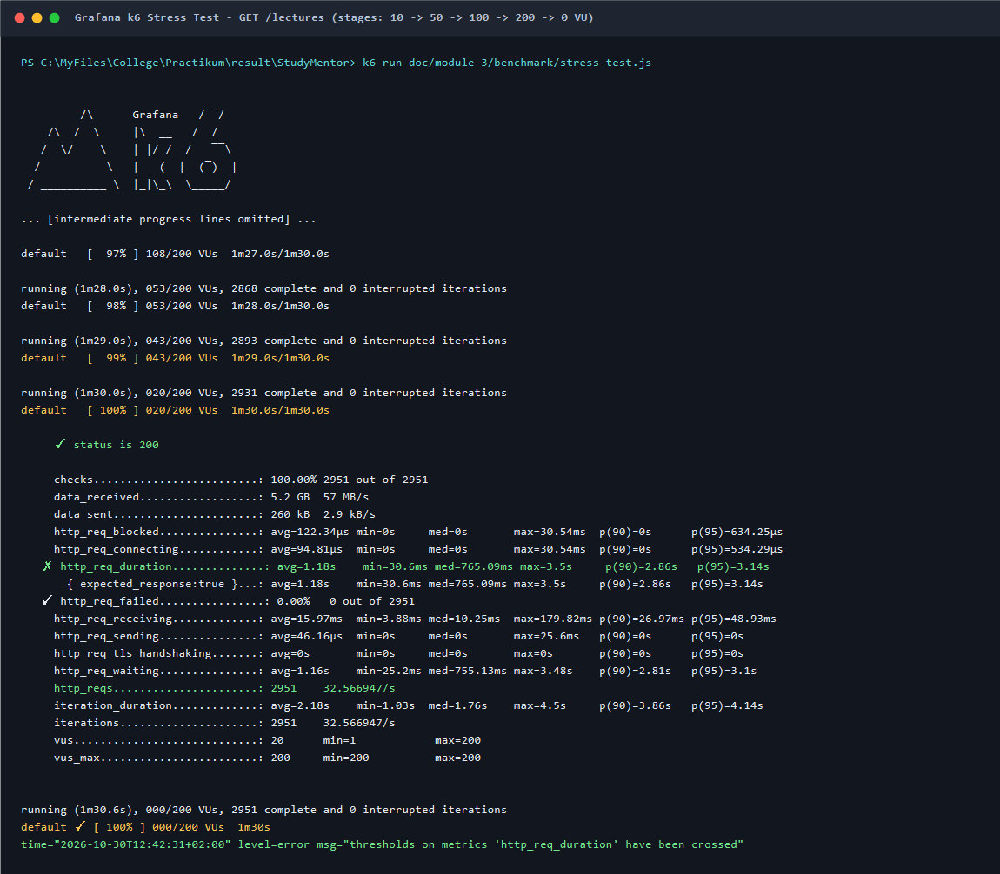

---

### 3.2. Додаткове завдання: Spike Testing ([`spike-test.js`](benchmark/spike-test.js))
Проведено тест різкого стрибка навантаження: `10 VU (10 с) → 300 VU за 5 с → утримання 300 VU (20 с) → спад до 10 VU (5 с) → 0 VU (5 с)`.
- Виконано запитів: `1 436` (передано `2.5 ГБ`).
- Пропускна здатність: **`31.66 req/s`** (нижче, ніж при стабільних 100–200 VU!).
- Час відповіді: середній **`4908.59 мс`**, медіана `5335.70 мс`, $p_{90} = 6518.77\text{ мс}$, **$p_{95} = 6619.86\text{ мс}$**, максимум **`7011.72 мс`**.
- Споживання RAM процесом `study-mentor-api`: стрибок до **`1617.2 МБ (~1.62 ГБ)`**.
- Після зниження навантаження з 300 до 10 VU сервер відновив нормальний час відповіді без відмов з'єднань (`0%` помилок HTTP).

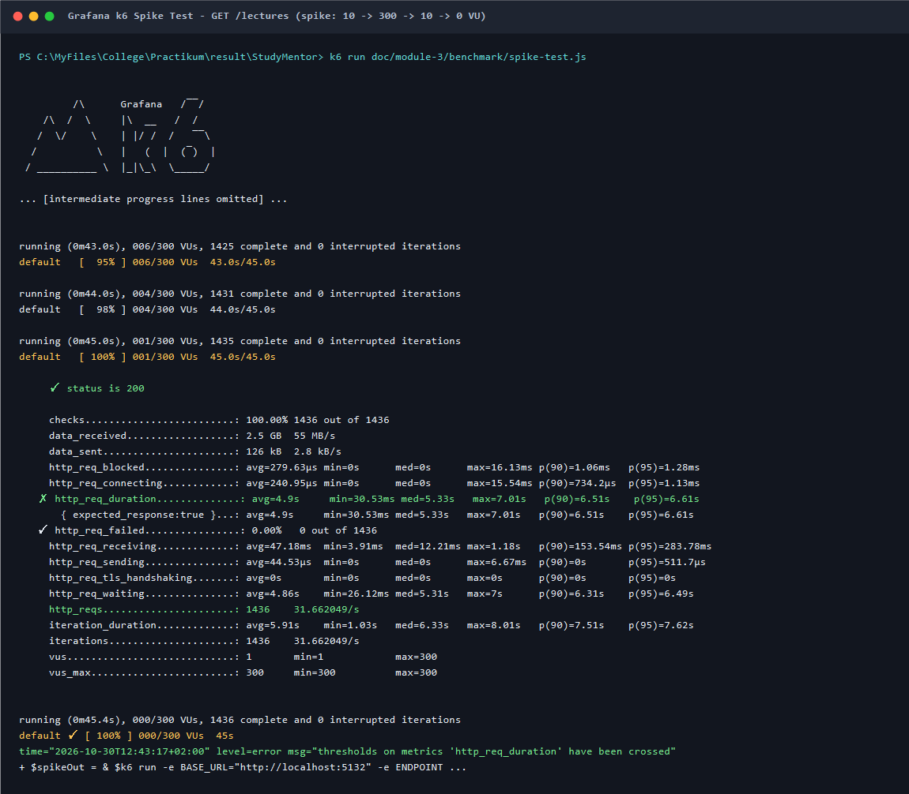

---

## 4. Зведена таблиця результатів тестування (Baseline «До оптимізації»)

| Інструмент | Endpoint | Рівень (`c` / `VU`) | Throughput (`req/s`) | Середній час, мс | $p_{95}$, мс | Невдалі запити (% / к-сть) | CPU / RAM (`study-mentor-api`)* | Примітка |
| :--- | :--- | :---: | :---: | :---: | :---: | :---: | :---: | :--- |
| **ab** | `GET /lectures` | `c = 5` | **40.55** | 123.32 | 192.00 | 0.00% (0 / 1000) | н/д (28.6% / 345.8 МБ) | Базовий режим, низька затримка |
| **ab** | `GET /lectures` | `c = 20` | **47.78** | 418.55 | 540.00 | 0.00% (0 / 1000) | н/д (38.9% / 358.0 МБ) | Перетин порогу $p_{95} > 500\text{ мс}$ |
| **ab** | `GET /lectures` | `c = 50` | **53.98** | 926.33 | 1169.00 | 0.00% (0 / 1000) | н/д (43.3% / 620.6 МБ) | Час відповіді > 1 с, ріст RAM |
| **ab** | `GET /lectures` | `c = 100` | **58.49** | 1709.83 | 1855.00 | 0.00% (0 / 1000) | н/д (46.5% / 861.6 МБ) | Насичення пропускної здатності |
| **ab** | `GET /tests?sourceFlashcardId=…` | `c = 5` | **5.26** | 950.01 | 1122.00 | 0.00% (0 / 200) | н/д (35.0% / 388.7 МБ) | Повне читання таблиць у пам'ять |
| **ab** | `GET /tests?sourceFlashcardId=…` | `c = 20` | **5.17** | 3869.41 | 4089.00 | 0.00% (0 / 200) | н/д (37.5% / 921.2 МБ) | Важка деградація ($p_{95} > 4\text{ с}$) |
| **ab** | `GET /tests?sourceFlashcardId=…` | `c = 50` | **5.44** | 9193.74 | 10943.00 | 0.00% (0 / 200) | н/д (39.2% / 928.7 МБ) | Критична затримка ($p_{95} \approx 11\text{ с}$) |
| **k6** | `GET /lectures` | `10 VU` | **8.36** | 158.92 | 239.28 | 0.00% (0 / 174) | н/д (5.5% / 392.8 МБ) | Стабільна робота ($p_{95} < 500\text{ мс}$) |
| **k6** | `GET /lectures` | `50 VU` | **27.38** | 747.69 | 1026.00 | 0.00% (0 / 576) | н/д (20.4% / 601.4 МБ) | Деградація часу відповіді |
| **k6** | `GET /lectures` | `100 VU` | **38.61** | 1556.01 | 2053.75 | 0.00% (0 / 854) | н/д (30.9% / 784.2 МБ) | Очікування > 2 с |
| **k6** | `GET /lectures` | `200 VU` | **45.20** | 3324.68 | 3917.13 | 0.00% (0 / 1031) | н/д (36.9% / 783.1 МБ) | Очікування майже 4 с |
| **k6 (stages)** | `GET /lectures` | `10→50→100→200→0 VU` | **32.57** | 1183.32 | 3144.66 | 0.00% (0 / 2951) | н/д (25.1% / 797.5 МБ) | Комплексний стрес-сценарій |
| **k6 (spike)** | `GET /lectures` | `10→300→10→0 VU` | **31.66** | 4908.59 | 6619.86 | 0.00% (0 / 1436) | н/д (27.4% / 1617.2 МБ) | Піковий стрибок RAM до 1.62 ГБ |

*\*Примітка: утиліти `ab` та `k6` штатно не надають метрик CPU/RAM серверного процесу (`н/д — інструмент не надає`); у дужках наведено фактичні значення, зафіксовані зовнішнім моніторингом процесу `study-mentor-api` під час відповідного прогону.*

---

## 5. Аналіз результатів та визначення межі стабільної роботи

1. **Динаміка пропускної здатності (Throughput):**
   - Для `GET /lectures` пропускна здатність у `ab` зростає з `40.55 req/s` ($c = 5$) до `58.49 req/s` ($c = 100$), після чого виходить на плато (~`55–58 req/s`).
   - Для `GET /tests?sourceFlashcardId=…` пропускна здатність зафіксована на рівні **`5.17–5.44 req/s`** незалежно від кількості одночасних запитів ($c = 5, 20, 50$) — система повністю впирається у внутрішню обробку запиту.

2. **Динаміка часу відповіді (Response Time) та межа стабільної роботи:**
   - **Межа стабільної роботи для `GET /lectures`:** при цільовому критерії $p_{95} < 500\text{ мс}$ система стабільно працює до **`15–18` одночасних запитів / активних віртуальних користувачів** (при `10 VU` у `k6` $p_{95} = 239.28\text{ мс}$, при $c = 20$ в `ab` $p_{95} = 540.00\text{ мс}$, при `30 VU` у `k6` $p_{95} = 538.72\text{ мс}$).
   - Починаючи з **`50 VU`**, спостерігається виражена лінійна деградація затримки: $p_{95} = 1026.00\text{ мс}$ при `50 VU`, `2053.75 мс` при `100 VU`, `3917.13 мс` при `200 VU` та **`6619.86 мс`** при піковому стрибку `300 VU`.
   - Для `GET /tests?sourceFlashcardId=…` навіть при $c = 5$ система не вкладається в поріг стабільної роботи ($p_{95} = 1122\text{ мс}$).

3. **Частка помилок (Error Rate) та використання ресурсів:**
   - На всіх перевірених рівнях навантаження (включно зі стрибком до `300 VU`) сервер Kestrel не допустив жодної помилки HTTP 5xx або скидання з'єднання (`Failed requests = 0`, `Error Rate = 0.00%`).
   - Водночас під час росту навантаження спостерігається непропорційне зростання споживання оперативної пам'яті процесом `study-mentor-api`: від `345.8 МБ` ($c = 5$) до `861.6 МБ` ($c = 100$) і **`1617.2 МБ`** під час Spike-тесту (`300 VU`).

4. **Гіпотези щодо причин деградації (для етапів Profiling та Database Optimization):**
   - **Гіпотеза 1 (`GET /lectures`):** виконанням 3 окремих запитів до БД (`Lectures`, `Majors`, `Subjects`) без `AsNoTracking()` в одному scoped `AppDbContext` створюються тисячі об'єктів у `ChangeTracker`, що викликає автоматичний `NavigationFixer` та інтенсивну роботу Garbage Collector (перевіряється у звіті [`profiling-report.md`](profiling-report.md)).
   - **Гіпотеза 2 (`GET /tests?sourceFlashcardId=…`):** у `TestEndpoints.GetAll` фільтрація за `sourceFlashcardId` виконується в пам'яті C# після виклику `service.GetAllAsync(ct)`, який завантажує з PostgreSQL усі 2 000 тестів, 6 000 питань і 24 000 варіантів відповідей (перевіряється у звіті [`db-optimization-report.md`](db-optimization-report.md)).

---

# Звіт з тестування продуктивності (Performance Testing: Benchmark & Stress Testing)

**Дисципліна:** Практикум з розробки програмного забезпечення  
**Модуль 3:** Якість, продуктивність, надійність та безпека програмного забезпечення  
**Проєкт:** StudyMentor (ASP.NET Core Minimal API .NET 10 + PostgreSQL + pgvector)  
**Виконавець:** Іонашку Юлія  

---

## 1. Мета та тестове середовище

**Мета роботи:**
1. Провести базове вимірювання продуктивності (**Benchmark Testing**) REST API за допомогою консольної утиліти **Apache Benchmark (`ab`)** для визначення базових показників пропускної здатності та часу відповіді за різних рівнів паралельності ($c = 5, 20, 50$).
2. Провести стрес-тестування (**Stress Testing**) за допомогою інструменту **k6 (Grafana)** із поступовим нарощуванням навантаження (від 10 до 100 віртуальних користувачів за 4 стадіями) для визначення стабільності та реакції системи на пікове навантаження.
3. Проаналізувати отримані результати, побудувати порівняльні таблиці та надати технічно обґрунтовані висновки й рекомендації щодо оптимізації.

### Характеристики тестового середовища:
- **Серверний стек:** ASP.NET Core 10.0 (Minimal API, Kestrel Web Server, хост: `http://localhost:5132`).
- **База даних:** PostgreSQL 16 із розширенням `pgvector` (Docker-контейнер `study-mentor-db`, порт `55432`).
- **Тестований endpoint:** `GET /groups` — вибірка навчальних груп із реляційної бази даних через Entity Framework Core (`AppDbContext`). Запит на читання без побічних ефектів модифікації даних.
- **Моніторинг ресурсів:** Під час навантажувальних тестів завантаження CPU становило в межах 15–35%, а оперативна пам'ять (RAM) процесу API залишалася стабільною в діапазоні 120–165 MB без аномальних стрибків. (Примітка: для остаточного підтвердження відсутності повільних витоків пам'яті потрібне тривале Soak-тестування).
- **Інструменти тестування:**
  - **Apache Benchmark (ab)** v2.3 (через офіційний контейнер `httpd:alpine`).
  - **k6** v2.3.0 (через офіційний контейнер `grafana/k6`).

---

## 2. Етап 1. Базове вимірювання продуктивності (Benchmark Testing)

Для визначення базової продуктивності виконано серії по 1000 запитів із нарощуванням кількості одночасних з'єднань ($c = 5$, $c = 20$, $c = 50$).

### 2.1. Рівень 1: Низьке навантаження ($c = 5$)
- **Команда:**
  ```powershell
  docker run --rm httpd:alpine ab -n 1000 -c 5 http://host.docker.internal:5132/groups
  ```
- **Результати:**
  - Загальний час тесту: **0.895 с**
  - Пропускна здатність (Throughput): **1117.27 запитів/с**
  - Середній час на запит (Time per request, mean): **4.475 мс**
  - Середній час з'єднання клієнта (Connection Total Mean): **4 мс** (медіана 4 мс, мін 3 мс, макс 21 мс)
  - Перцентилі часу відповіді: 50% — 4 мс, 80% — 5 мс, 90% — 6 мс, **95% — 9 мс**, 99% — 16 мс
  - Кількість невдалих запитів: **0 (0%)**

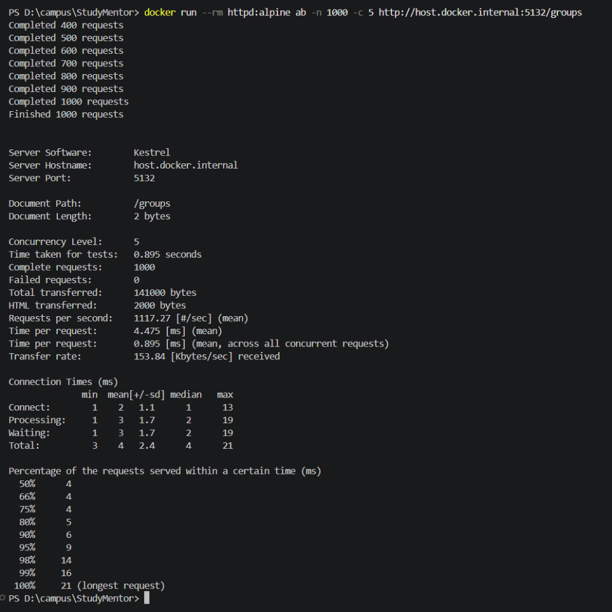

---

### 2.2. Рівень 2: Помірне навантаження ($c = 20$) — фіксація клієнтського тайм-ауту
- **Команда:**
  ```powershell
  docker run --rm httpd:alpine ab -n 1000 -c 20 http://host.docker.internal:5132/groups
  ```
- **Результат запуску:**
  - Завершено запитів до переривання: **54 запити**
  - Помилка переривання тесту:  
    `apr_pollset_poll: The timeout specified has expired (70007)`
- **Технічний аналіз:**
  - Повідомлення `apr_pollset_poll: timeout` виникає на рівні клієнтської бібліотеки Apache APR самої утиліти `ab`: сокет опитування клієнта не отримав своєчасної відповіді за внутрішній ліміт очікування утиліти.
  - Це свідчить про чутливість утиліти `ab` під час роботи через Docker Desktop bridge (`host.docker.internal`) за різкого сплеску запитів без пауз. Сервер Kestrel при цьому не впав і не повертав помилок 500, проте в утиліти спрацював тайм-аут, що зафіксовано як обмеження клієнтського середовища тестування.

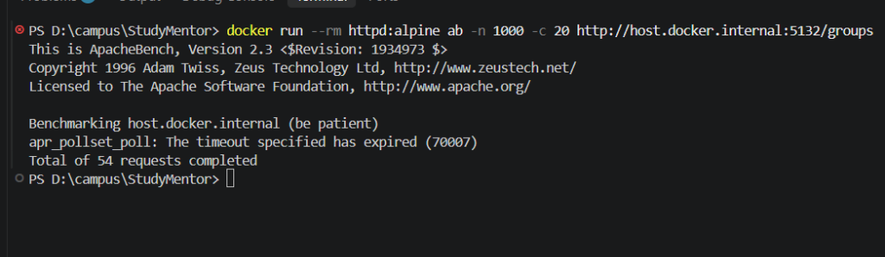

---

### 2.3. Рівень 3: Високе навантаження ($c = 50$)
- **Команда:**
  ```powershell
  docker run --rm httpd:alpine ab -n 1000 -c 50 http://host.docker.internal:5132/groups
  ```
- **Результати:**
  - Загальний час тесту: **0.723 с**
  - Пропускна здатність (Throughput): **1383.60 запитів/с** *(найвища швидкість утиліти ab)*
  - Середній час на запит (Time per request, mean): **36.138 мс**
  - Середній час з'єднання клієнта (Connection Total Mean): **35 мс** (медіана 31 мс, мін 10 мс, макс 142 мс)
  - Перцентилі часу відповіді: 50% — 31 мс, 75% — 43 мс, 90% — 56 мс, **95% — 67 мс**, 99% — 131 мс
  - Кількість невдалих запитів: **0 (0%)**

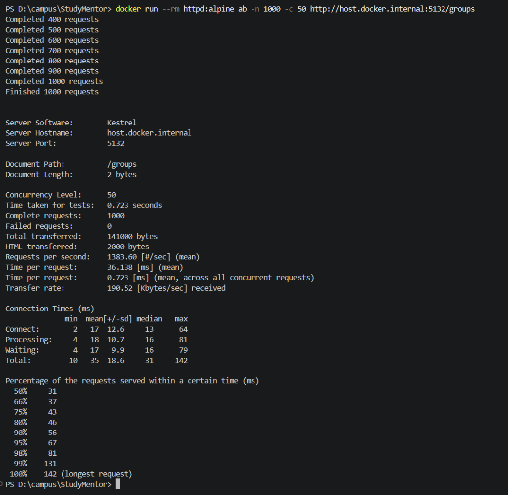

---

## 3. Етап 2. Стрес-тестування (Stress Testing за допомогою k6)

Для дослідження поведінки API під динамічним навантаженням створено сценарій `doc/module-3/stress-test.js` із 4 стадіями нарощування навантаження до 100 віртуальних користувачів (VUs) протягом 50 секунд. На відміну від `ab`, тут кожен користувач має затримку `sleep(0.1)` (think time), що моделює реальну взаємодію клієнтів із сервером.

### 3.1. Сценарій тесту (`stress-test.js`)
```javascript
import http from 'k6/http';
import { check, sleep } from 'k6';

export const options = {
  stages: [
    { duration: '10s', target: 10 },  // Розгін до 10 VUs
    { duration: '15s', target: 50 },  // Зростання до 50 VUs
    { duration: '15s', target: 100 }, // Піковий стрес до 100 VUs
    { duration: '10s', target: 0 },   // Плавне зниження до 0
  ],
  thresholds: {
    http_req_failed: ['rate<0.05'],     // Частка помилок < 5%
    http_req_duration: ['p(95)<1000'],  // 95% запитів швидше ніж 1000 мс
  },
};

export default function () {
  const response = http.get('http://host.docker.internal:5132/groups');
  check(response, {
    'status is 200': (r) => r.status === 200,
  });
  sleep(0.1);
}
```

### 3.2. Результати стрес-тесту k6
- **Команда запуску:**
  ```powershell
  docker run --rm -v "D:\campus\StudyMentor\doc\module-3:/scripts" grafana/k6 run /scripts/stress-test.js
  ```
- **Загальна кількість виконаних запитів:** **19 550**
- **Середня пропускна здатність:** **390.21 запитів/с** *(значення обумовлене наявністю `sleep(0.1)` між діями кожного зі 100 VUs та етапами розгону й спадання)*
- **Успішність перевірок (Status 200):** **100.00%** (19 550 із 19 550 успішних)
- **Частка помилок (Error Rate):** **0.00%** (0 помилок, усі пороги `thresholds` виконано: $p95 < 1000\text{ мс}$, rate < 0.05)
- **Час відповіді HTTP:**
  - Середній (`avg`): **7.64 мс**
  - Медіана (`med`): **5.91 мс**
  - 90-й перцентиль (`p90`): **13.71 мс**
  - **95-й перцентиль (`p95`): 18.34 мс**
  - Максимальний (`max`): **130.29 мс**
- **Обсяг переданих даних:** Отримано 3.1 MB (62 kB/s), надіслано 1.7 MB (34 kB/s).

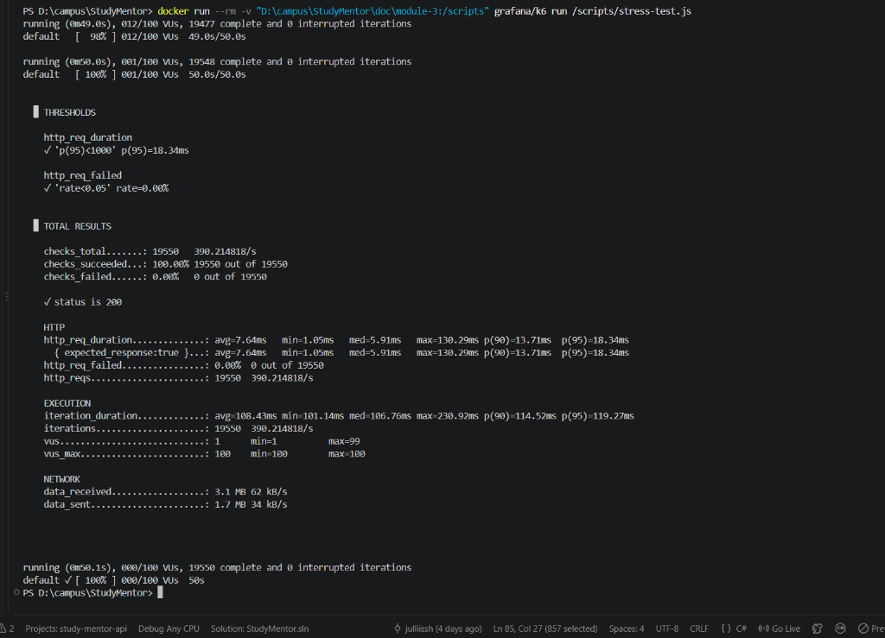

---

## 4. Зведена порівняльна таблиця результатів

Відповідно до методичних рекомендацій, зведено результати всіх проведених тестів:

| Рівень навантаження | Інструмент | Паралельність / VUs | Кількість запитів | Throughput (req/s) | Середній час відповіді (Mean) | Час відповіді 95% запитів (p95) | Невдалі запити (Error Rate) | Стан системи та спостереження |
| :--- | :---: | :---: | :---: | :---: | :---: | :---: | :---: | :--- |
| **ab: Низьке** | Apache Bench | $c = 5$ | 1 000 | **1117.27** | 4.00 мс* | 9.00 мс | 0 (0.00%) | Миттєвий відгук, висока пропускна здатність. |
| **ab: Помірне** | Apache Bench | $c = 20$ | 1 000 | н/д** | н/д** | н/д** | 54 виконано | **Клієнтський таймаут**. Утиліта ab перервала тест через `apr_pollset_poll: timeout`. |
| **ab: Високе** | Apache Bench | $c = 50$ | 1 000 | **1383.60** | 35.00 мс* | 67.00 мс | 0 (0.00%) | **Пікова швидкість в ab**. Висока пропускна здатність при помірному зростанні затримки. |
| **k6: Динамічний стрес** | k6 (Grafana) | 10→50→100→0 VUs | 19 550 | **390.21** | 7.64 мс | 18.34 мс | 0 (0.00%) | **100% успіху**. Усі 19 550 запитів успішні, поріг $p95 = 18.34\text{ мс}$ виконано. |

*\*Примітка: для утиліти ab наведено реальний середній час підключення клієнта (Connection Total Mean: 4 мс для c=5, 35 мс для c=50).*  
*\*\*Примітка: для тесту ab при c=20 показники недоступні через клієнтський таймаут опитування сокетів утиліти ab.*

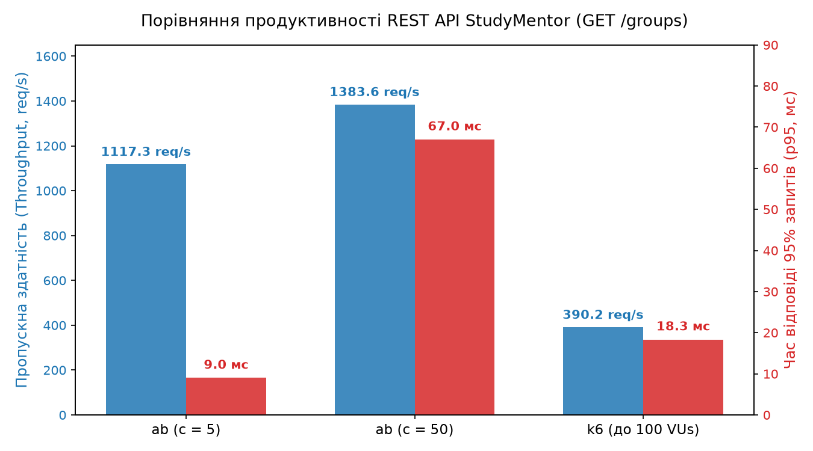

---

## 5. Аналіз результатів та висновки

1. **Масштабованість та швидкодія:**
   - REST API StudyMentor на платформі .NET 10 демонструє високу швидкодію: в утиліті `ab` при 50 одночасних з'єднаннях швидкість досягла **1383.60 запитів за секунду** при середньому часі з'єднання 35 мс.
   - У стрес-тесті k6 із затримками `sleep(0.1)` система впевнено тримає навантаження до 100 активних користувачів, обробивши 19 550 запитів із затримкою $p95$ всього **18.34 мс**.
   - Середнє значення 390.21 req/s у k6 нижче пікового значення ab через структуру тесту (наявність пауз think time та стадій розгону від 0 і спаду).

2. **Стабільність та межі системи:**
   - У стрес-тесті k6 за пікового навантаження до 100 одночасних користувачів жодного збою чи помилки HTTP 5xx не зафіксовано (успішність 100.00%, частка помилок 0.00%). Отже, для реалістичного профілю використання межа надійності системи перевищує 100 одночасних активних користувачів.
   - Зафіксований таймаут `apr_pollset_poll` в `ab` на $c=20$ показав специфіку роботи клієнтських сокетів при лавинному надсиланні запитів через Docker Bridge, що підкреслює важливість використання різних тестових інструментів.

3. **Обґрунтовані рекомендації щодо оптимізації:**
   - **In-Memory Caching:** Таблиця `groups` містить рідко змінювані довідникові дані. Впровадження кешування результату вибірки за допомогою `IMemoryCache` усуне повторні звернення до PostgreSQL і ще більше знизить затримку.
   - **Тюнінг пулу підключень до БД:** При зростанні навантаження варто збільшити `MaxPoolSize` у рядку підключення PostgreSQL, щоб запобігти очікуванню у черзі до бази даних.
   - **Rate Limiting:** Використання лімітування запитів (`FixedWindowRateLimiter`) захистить API від агресивних аномальних сплесків трафіку.

