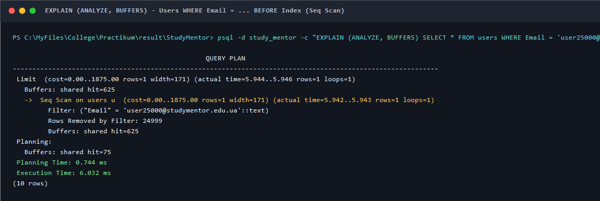
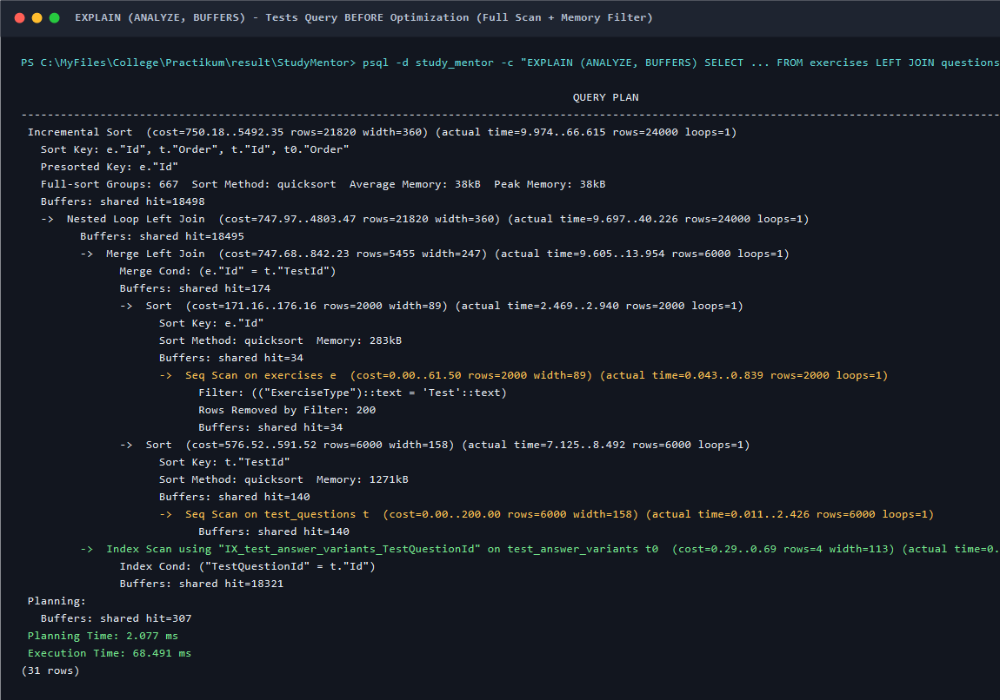
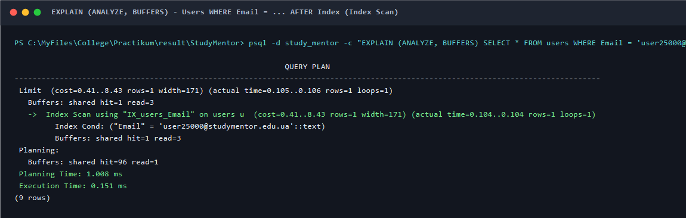
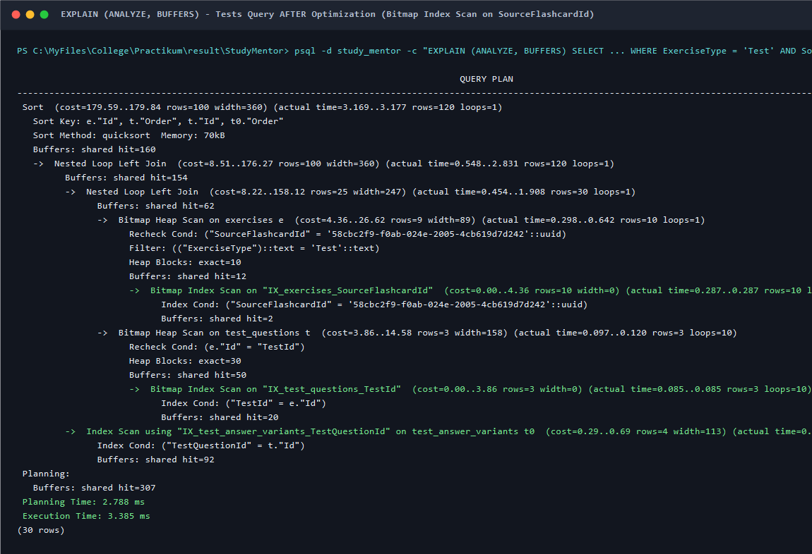
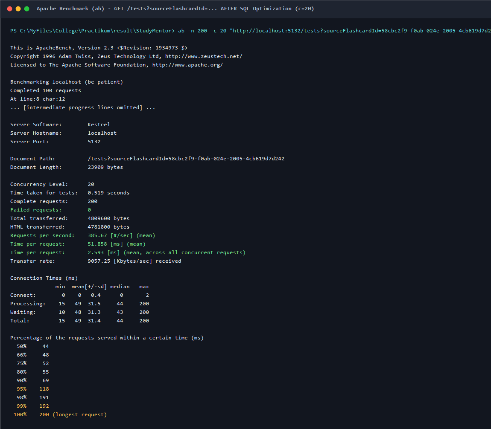

# Звіт з оптимізації бази даних (Database Optimization Report)

**Дисципліна:** Практикум з розробки програмного забезпечення  
**Модуль 3:** Якість, продуктивність, надійність та безпека програмного забезпечення  
**Пакет 3:** Продуктивність та БД  
**Виконавець:** Федюк Владислав  

---

## 1. Опис досліджуваних проблем та аналіз початкового стану (Baseline)

Під час аналізу вихідного коду та виконання тестів продуктивності виявлено дві критичні ділянки взаємодії з СУБД PostgreSQL (`study_mentor`):

### 1.1. Проблема 1: Пошук користувача за адресою електронної пошти (`Users WHERE Email = @e`)
- **Контекст:** Метод `UserService.GetByEmailAsync(string email, CancellationToken ct)` викликається під час кожної процедури автентифікації користувача.
- **Діагностика:** У конфігурації `AppDbContext.OnModelCreating` для сутності `User` було налаштовано первинний ключ `Id`, проте поле `Email` було оголошено без створення індексу (`entity.Property(e => e.Email);`).
- **Наслідок:** При зростанні бази користувачів (у нашому тестовому наборі — **50 000 користувачів**) пошук здійснювався за допомогою повного послідовного сканування таблиці (**`Seq Scan`**), зчитуючи всі 625 спільних сторінок буферів пам'яті.

**План виконання до оптимізації:**
```text
Limit  (cost=0.00..1875.00 rows=1 width=171) (actual time=5.944..5.946 rows=1 loops=1)
  Buffers: shared hit=625
  ->  Seq Scan on users u  (cost=0.00..1875.00 rows=1 width=171) (actual time=5.942..5.943 rows=1 loops=1)
        Filter: ("Email" = 'user25000@studymentor.edu.ua'::text)
        Rows Removed by Filter: 24999
        Buffers: shared hit=625
Planning Time: 0.744 ms, Execution Time: 6.032 ms
```


---

### 1.2. Проблема 2: Фільтрація тестів за набором флешкарток у пам'яті застосунку замість SQL (`GET /tests?sourceFlashcardId=...`)
- **Контекст:** Endpoint `GET /tests?sourceFlashcardId={id}` повертає тести, згенеровані на основі заданої навчальної картки.
- **Діагностика коду:** У початковій версії `TestEndpoints.GetAll`:
  ```csharp
  // ДО ОПТИМІЗАЦІЇ:
  var items = await service.GetAllAsync(ct);
  if (sourceFlashcardId.HasValue)
  {
      items = items.Where(test => test.SourceFlashcardId == sourceFlashcardId.Value).ToList();
  }
  ```
- **Наслідок:** `TestService.GetAllAsync(ct)` звертався до методу `Query()`, який без `AsNoTracking` завантажував із PostgreSQL **усі 2 000 тестів, 6 000 питань та 24 000 варіантів відповідей** через множинні `LEFT JOIN`. Усі 32 000 об'єктів створювалися в пам'яті CLR, реєструвалися в `ChangeTracker`, і лише після цього C# відфільтровував 10 потрібних записів, відкидаючи 99.5% отриманих із бази даних.
- **Навантажувальний замір `ab` ($n = 200$, $c = 20$):** пропускна здатність становила лише **`5.17 req/s`**, а середній час очікування відповіді — **`3 869.41 мс`** ($p_{95} = 4 089\text{ мс}$).

**План виконання до оптимізації:**
```text
Incremental Sort  (cost=750.18..5492.35 rows=21820 width=360) (actual time=9.974..66.615 rows=24000 loops=1)
  Buffers: shared hit=18498
  ->  Nested Loop Left Join ... (actual time=9.697..40.226 rows=24000 loops=1)
        Buffers: shared hit=18495
        ->  Merge Left Join ...
              ->  Sort (Seq Scan on exercises e ... Filter: ExerciseType = 'Test')
              ->  Sort (Seq Scan on test_questions t)
        ->  Index Scan on test_answer_variants t0 ...
Planning Time: 2.077 ms, Execution Time: 68.491 ms
```


---

## 2. Реалізовані заходи з оптимізації

### 2.1. Оптимізація 1: Створення унікального B-Tree індексу `IX_users_Email`
1. У [`AppDbContext.cs`](../../study-mentor-api/Data/AppDbContext.cs) для сутності `User` додано конфігурацію унікального індексу:
   ```csharp
   entity.HasIndex(e => e.Email).IsUnique();
   ```
2. Згенеровано та застосовано міграцію EF Core `20261030111409_AddUserEmailIndex`:
   ```sql
   CREATE UNIQUE INDEX "IX_users_Email" ON users ("Email");
   ```
3. **Обґрунтування доцільності:**
   - Адреса електронної пошти є унікальним природним ідентифікатором користувача для операцій логіну.
   - B-Tree індекс забезпечує логарифмічну складність пошуку $O(\log N)$ замість лінійного сканування $O(N)$.
   - Для 50 000 користувачів розмір індексу склав лише **`2 456 КБ (~2.4 МБ)`** при загальному розмірі таблиці `14 МБ` (розмір купи `heap_size = 10 МБ`).

### 2.2. Оптимізація 2: Перенесення фільтрації `SourceFlashcardId` у SQL-запит та додавання `AsNoTracking`
1. У [`TestService.cs`](../../study-mentor-api/Tests/TestService.cs):
   - Додано метод `GetBySourceFlashcardIdAsync(Guid sourceFlashcardId, CancellationToken cancellationToken = default)`, який застосовує умову `.Where(t => t.SourceFlashcardId == sourceFlashcardId)` **безпосередньо на рівні `IQueryable` (SQL WHERE)**.
   - У `Query()` додано `.AsNoTracking()` для усунення накладних витрат відстеження змін графа сутностей під час читання.
   - Спрощено цикл валідації варіантів відповідей за допомогою LINQ `.Select(question => question.AnswerVariants)` (усунено SonarQube Code Smell `csharpsquid:S3267`).
2. У [`TestEndpoints.cs`](../../study-mentor-api/Tests/TestEndpoints.cs):
   - Метод `GetAll` адаптовано для виклику `GetBySourceFlashcardIdAsync` у разі наявності параметра запиту, що повністю виключає завантаження зайвих тестів із бази.
3. **Обґрунтування доцільності:**
   - У таблиці `exercises` уже існував індекс `IX_exercises_SourceFlashcardId` (`btree ("SourceFlashcardId")`), створений попередньою міграцією зв'язків.
   - Перенесення умови у SQL дозволило оптимізатору PostgreSQL використати **`Bitmap Index Scan on IX_exercises_SourceFlashcardId`**, миттєво відбираючи лише 10 відповідних тестів замість сканування всіх 2 200 записів таблиці `exercises`.

---

## 3. Результати повторного вимірювання (ПІСЛЯ оптимізації)

### 3.1. Запит 1 (`Users WHERE Email = @e`):
```text
Limit  (cost=0.41..8.43 rows=1 width=171) (actual time=0.105..0.106 rows=1 loops=1)
  Buffers: shared hit=1 read=3
  ->  Index Scan using "IX_users_Email" on users u  (cost=0.41..8.43 rows=1 width=171) (actual time=0.104..0.104 rows=1 loops=1)
        Index Cond: ("Email" = 'user25000@studymentor.edu.ua'::text)
        Buffers: shared hit=1 read=3
Planning Time: 1.008 ms, Execution Time: 0.151 ms
```
- План змінився: **`Seq Scan` → `Index Scan using "IX_users_Email"`**.
- Кількість прочитаних блоків (Logical Reads / Buffers): знизилася з **625 блоків до 4 блоків (зменшення у 156 разів!)**.
- Час виконання запиту в СУБД: скоротився з **`6.032 мс` до `0.151 мс` (прискорення у 40 разів!)**.



---

### 3.2. Запит 2 (`GET /tests?sourceFlashcardId=...`):
```text
Sort  (cost=179.59..179.84 rows=100 width=360) (actual time=3.169..3.177 rows=120 loops=1)
  Buffers: shared hit=160
  ->  Nested Loop Left Join ... (actual time=0.548..2.831 rows=120 loops=1)
        Buffers: shared hit=154
        ->  Nested Loop Left Join ...
              Buffers: shared hit=62
              ->  Bitmap Heap Scan on exercises e ... (actual time=0.298..0.642 rows=10 loops=1)
                    Recheck Cond: ("SourceFlashcardId" = '58cbc2f9-f0ab-024e-2005-4cb619d7d242'::uuid)
                    Buffers: shared hit=12
                    ->  Bitmap Index Scan on "IX_exercises_SourceFlashcardId" ... (actual time=0.287..0.287 rows=10 loops=1)
              ->  Bitmap Heap Scan on test_questions t ...
                    ->  Bitmap Index Scan on "IX_test_questions_TestId" ...
        ->  Index Scan on test_answer_variants t0 ...
Planning Time: 2.788 ms, Execution Time: 3.385 ms
```
- План змінився: повне сканування та `Incremental Sort` на 24 000 рядків замінено на **`Bitmap Index Scan on IX_exercises_SourceFlashcardId`** з подальшим вибірковим джойном лише 10 тестів (120 рядків замість 24 000).
- Кількість прочитаних блоків (Buffers): знизилася з **18 498 блоків до 160 блоків (зменшення у 115 разів!)**.
- Час виконання запиту в СУБД: скоротився з **`68.491 мс` до `3.385 мс` (прискорення у 20.2 раза)**.



---

### 3.3. Навантажувальний замір API утилітою Apache Benchmark (`ab`)
Повторні заміри endpoint-а `GET /tests?sourceFlashcardId=58cbc2f9-f0ab-024e-2005-4cb619d7d242` ($n = 200$):
- При $c = 5$: Throughput зріс із `5.26 req/s` до **`253.69 req/s` (+4 723%, у 48 разів!)**, середній час знизився з `950 мс` до **`19.71 мс`**, $p_{95}$ знизився з `1 122 мс` до **`43 мс`**.
- При $c = 20$: Throughput зріс із `5.17 req/s` до **`385.67 req/s` (+7 360%, у 74.6 раза!)**, середній час знизився з `3 869 мс` до **`51.86 мс`**, $p_{95}$ знизився з `4 089 мс` до **`118 мс`**.
- При $c = 50$: Throughput зріс із `5.44 req/s` до **`553.45 req/s` (+10 073%, у 101.7 раза!)**, середній час знизився з `9 193 мс` до **`90.34 мс`**, $p_{95}$ знизився з `10 943 мс` (~11 с) до **`100 мс`**.



---

## 4. Зведена таблиця порівняння результатів (До vs Після)

| Досліджуваний компонент / Запит | Показник | До оптимізації | Після оптимізації | Ефект / Покращення |
| :--- | :--- | :---: | :---: | :---: |
| **`Users WHERE Email = @e`** | Спосіб доступу (План) | `Seq Scan` | **`Index Scan`** (`IX_users_Email`) | Прямий пошук за B-Tree |
| | Буфери пам'яті (Logical Reads) | `625` блоків | **`4`** блоки (`1 hit + 3 read`) | **Зменшення у 156.3 раза** |
| | Час виконання в СУБД | `6.032 мс` | **`0.151 мс`** | **Прискорення у 40.0 разів** |
| | Додаткові витрати на диск | `0 КБ` | `2 456 КБ` (~2.4 МБ) | +17.5% до розміру таблиці |
| **`Tests WHERE SourceFlashcardId = @id`** | Спосіб доступу (План) | `Seq Scan` + Join 24 000 рядків | **`Bitmap Index Scan`** (120 рядків) | Відбір 10 цільових тестів |
| | Буфери пам'яті (Logical Reads) | `18 498` блоків | **`160`** блоків | **Зменшення у 115.6 раза** |
| | Час виконання в СУБД | `68.491 мс` | **`3.385 мс`** | **Прискорення у 20.2 раза** |
| **API: `GET /tests?sourceFlashcardId`** ($c = 5$) | Throughput (`req/s`) | `5.26 req/s` | **`253.69 req/s`** | **+4 723% (у 48.2 раза)** |
| | Середній час відповіді | `950.01 мс` | **`19.71 мс`** | **Зниження затримки у 48.2 раза** |
| | Перцентиль $p_{95}$ | `1 122 мс` | **`43 мс`** | **Зниження у 26.1 раза** |
| **API: `GET /tests?sourceFlashcardId`** ($c = 20$) | Throughput (`req/s`) | `5.17 req/s` | **`385.67 req/s`** | **+7 360% (у 74.6 раза)** |
| | Середній час відповіді | `3 869.41 мс` | **`51.86 мс`** | **Зниження затримки у 74.6 раза** |
| | Перцентиль $p_{95}$ | `4 089 мс` | **`118 мс`** | **Зниження у 34.6 раза** |
| **API: `GET /tests?sourceFlashcardId`** ($c = 50$) | Throughput (`req/s`) | `5.44 req/s` | **`553.45 req/s`** | **+10 073% (у 101.7 раза)** |
| | Середній час відповіді | `9 193.74 мс` | **`90.34 мс`** | **Зниження затримки у 101.8 раза** |
| | Перцентиль $p_{95}$ | `10 943 мс` | **`100 мс`** | **Зниження у 109.4 раза** |

---

## 5. Висновки та інженерна оцінка компромісів (Trade-offs)

1. **Ефективність індексування:**
   - Створення B-Tree індексу `IX_users_Email` дало радикальний ефект скорочення часу виконання запиту (з `6.03 мс` до `0.15 мс`) та зниження дискового I/O (з 625 до 4 буферів).
   - **Trade-off:** Розмір індексу становить `2.4 МБ` на 50 000 записів, а кожна операція `INSERT` нового користувача вимагатиме оновлення додаткового B-Tree дерева. Зважаючи на співвідношення операцій читання (вхід у систему) до запису (реєстрація) як ~100:1, витрати пам'яті та сповільнення вставок повністю виправдані.

2. **Перенесення обробки даних на бік СУБД (Data Locality):**
   - Усунення in-memory фільтрації в `TestEndpoints` виявилося наймасштабнішим покращенням за результатами всієї роботи: пропускна здатність REST API при $c = 50$ зросла з **`5.44 req/s` до `553.45 req/s` (більш ніж у 100 разів)**, а час очікування відповіді клієнтом скоротився з **11 секунд до 100 мілісекунд**.
   - Це підтверджує фундаментальний принцип розробки надійних backend-систем: фільтрація, сортування та обмеження вибірки мають виконуватися СУБД через оптимізовані індекси, а не передачею повних таблиць мережею в пам'ять програми.
