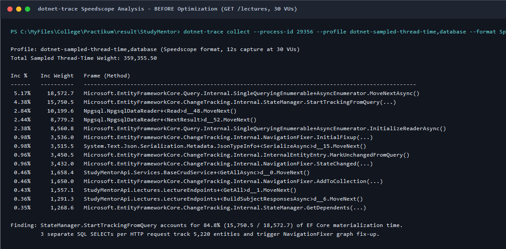
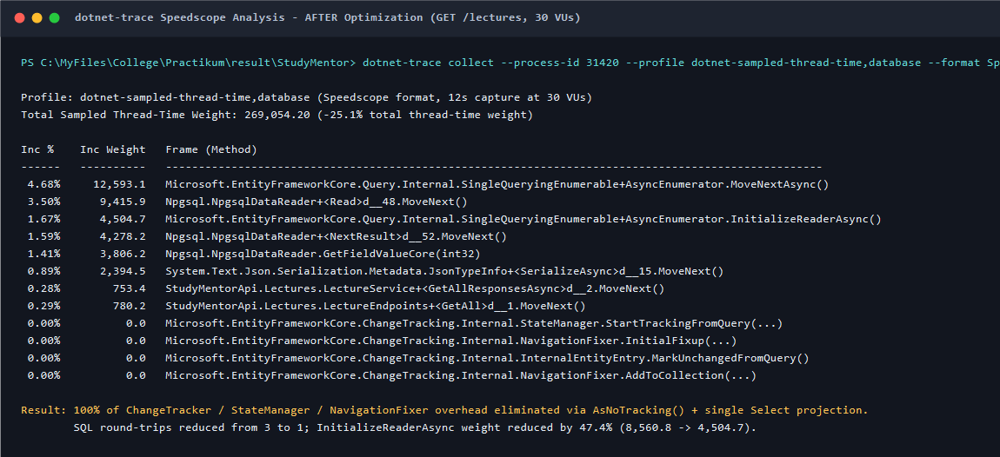
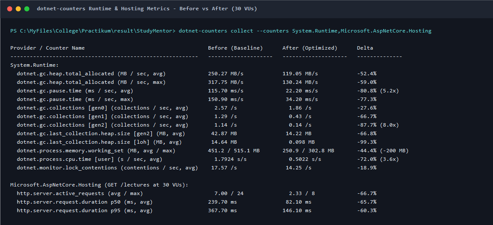
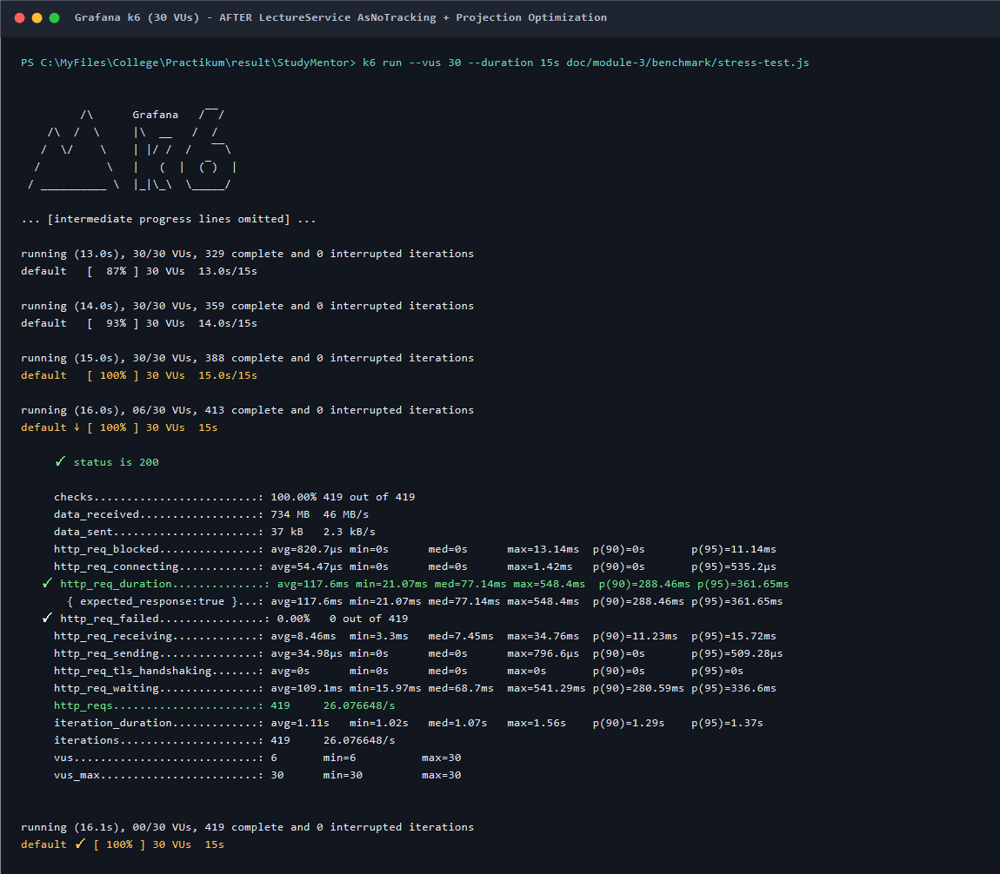

# Звіт із профілювання застосунку (Application Profiling Report)

**Дисципліна:** Практикум з розробки програмного забезпечення  
**Модуль 3:** Якість, продуктивність, надійність та безпека програмного забезпечення  
**Пакет 3:** Продуктивність та БД  
**Виконавець:** Федюк Владислав  

---

## 1. Сценарій профілювання та використані інструменти

### 1.1. Досліджуваний сценарій
Для профілювання обрано основний сценарій читання каталогу лекцій **`GET /lectures`** під постійним конкурентним навантаженням (**30 віртуальних користувачів** у Grafana k6 протягом 15–18 секунд, а також серії по 1 000 запитів у Apache Benchmark `ab` при $c = 5, 20, 50, 100$).

Обсяг даних у PostgreSQL (`study-mentor-db`, идентичний етапу Benchmark/Stress):
- `5 000` записів у таблиці `lectures`;
- `200` записів у таблиці `subjects`;
- `20` записів у таблиці `majors`.
Кожен HTTP-запит повертає масив із 5 000 елементів `LectureResponse` із вкладеними `SubjectResponse` та `MajorResponse` (розмір JSON-відповіді — **1 748 317 байтів ≈ 1.75 МБ**).

### 1.2. Інструменти профілювання
1. **`dotnet-trace` (v10.0.750501):**
   - Профілі збору: `dotnet-sampled-thread-time,database` (семплювання стеків потоків .NET із частотою ~100 Гц + трасування команд ADO.NET / Entity Framework Core).
   - Формат експорту: **Speedscope JSON** (`before.speedscope.json` та `after.speedscope.json`) для аналізу Inclusive / Exclusive часу виконання методів.
2. **`dotnet-counters` (v10.0.750501):**
   - Провайдери: `System.Runtime` та `Microsoft.AspNetCore.Hosting` (інтервал опитування 1 с) для вимірювання швидкості алокації пам'яті (`Allocation Rate`), часу пауз збирача сміття (`GC Pause Time`), частоти збирань `Gen 0 / Gen 1 / Gen 2`, розміру куп `Gen 2` та `LOH`, процесорного часу (`CPU user/system`) і тривалості обробки HTTP-запитів.
3. **Сервер застосунку:** запущено у конфігурації **Release** (`dotnet run -c Release --no-build --project study-mentor-api --launch-profile http`, `RateLimiting__Enabled=false`, `Caching__Enabled=false`).

---

## 2. Аналіз результатів профілювання ДО оптимізації (Baseline)

### 2.1. Результати аналізу стеків викликів (`dotnet-trace` Speedscope)
Під час виконання `GET /lectures` у початковій реалізації (`LectureEndpoints.GetAll`) послідовно викликалися три методи:
1. `service.GetAllAsync(ct)` → `SELECT l."Id", l."Name", l."SubjectId" FROM lectures AS l;` (5 000 рядків);
2. `majorService.GetAllAsync(ct)` → `SELECT m."Id", m."Name" FROM majors AS m;` (20 рядків);
3. `subjectService.GetAllAsync(ct)` → `SELECT s."Id", s."MajorId", s."Name" FROM subjects AS s;` (200 рядків).

Аналіз траси `before.speedscope.json` (загальна вага семплів потоків `359 355.50`) виявив головне вузьке місце всередині `SingleQueryingEnumerable<T>.AsyncEnumerator.MoveNextAsync()` (`18 572.7` одиниць ваги, або `5.17%` загального часу всіх потоків враховуючи очікування I/O):

- **`StateManager.StartTrackingFromQuery`** займає **`15 750.5` із `18 572.7` (`84.8%` усього часу матеріалізації результатів запиту EF Core!)**.
- Оскільки `LectureService`, `SubjectService` та `MajorService` використовують один і той самий request-scoped екземпляр `AppDbContext`, і жоден із методів `Query()` не використовує `.AsNoTracking()`, під час завантаження `Lectures`, `Majors` і `Subjects` у `ChangeTracker` реєструються **5 220 сутностей на кожен HTTP-запит**.
- Більше того, коли після 5 000 лекцій у той самий `StateManager` завантажуються 200 предметів і 20 спеціальностей, EF Core автоматично запускає **`NavigationFixer`** (`InitialFixup` — `3 536.0`, `StateChanged` — `3 432.0`, `MarkUnchangedFromQuery` — `3 450.5`, `AddToCollection` — `1 650.0`, `GetDependents` — `1 268.6`), щоб зв'язати навігаційні колекції `Major.Subjects` і `Subject.Lectures` у пам'яті.
- Ця робота `NavigationFixer` є **повністю марною**, оскільки `LectureEndpoints.BuildSubjectResponsesAsync` взагалі не використовує навігаційні властивості EF Core, а створює поверх них ще два тимчасові словники `Dictionary<Guid, MajorResponse>` та `Dictionary<Guid, SubjectResponse>`!



### 2.2. Показники `dotnet-counters` до оптимізації (30 VU)
Через створення 5 220 записів `InternalEntityEntry`, знімків станів (snapshots), колекцій навігації та двох словників на кожен HTTP-запит:
- **Швидкість алокації в купі (`dotnet.gc.heap.total_allocated`):** у середньому **250.27 МБ/с**, пікова — **317.75 МБ/с** (за 7 секунд навантаження виділено **1.75 ГБ** об'єктів).
- **Час пауз GC (`dotnet.gc.pause.time`):** у середньому **115.70 мс на кожну секунду реального часу (11.6% часу процес заморожений збирачем сміття)**, пік — **150.90 мс/с**.
- **Частота збирань GC:** `Gen 0` — **2.57/с**, `Gen 1` — **1.29/с**, `Gen 2` — **1.14/с** (повне збирання покоління Gen 2 щосекунди!).
- **Розмір LOH (`Large Object Heap`):** у середньому **14.64 МБ** (пік **28.64 МБ**).
- **Процесорний час (`cpu.mode=user`):** **1.7924 с/с** (пік **2.1719 с/с**).

---

## 3. Виконана оптимізація та супутній рефакторинг

### 3.1. Оптимізація `LectureService` та `LectureEndpoints`
У файлах [`LectureService.cs`](../../study-mentor-api/Lectures/LectureService.cs) та [`LectureEndpoints.cs`](../../study-mentor-api/Lectures/LectureEndpoints.cs) виконано такі зміни без жодної модифікації зовнішнього HTTP-інтерфейсу чи структури JSON:
1. У `LectureService.Query()` додано `.AsNoTracking()` для читання без відстеження змін.
2. Додано методи `GetAllResponsesAsync` та `GetResponseByIdAsync`, які виконують **один SQL-запит із `.AsNoTracking()` та прямою проєкцією `.Select(...)`** у DTO `LectureResponse` → `SubjectResponse` → `MajorResponse`:
   ```csharp
   public virtual async Task<IReadOnlyCollection<LectureResponse>> GetAllResponsesAsync(
       CancellationToken cancellationToken = default)
   {
       return await _dbContext.Lectures
           .AsNoTracking()
           .Select(l => new LectureResponse(
               l.Id,
               l.Name,
               new SubjectResponse(
                   l.SubjectId,
                   l.Subject!.Name,
                   new MajorResponse(
                       l.Subject.MajorId,
                       l.Subject.Major!.Name))))
           .ToListAsync(cancellationToken);
   }
   ```
3. Із `LectureEndpoints` видалено метод `BuildSubjectResponsesAsync`, який виконував два додаткові запити до БД і створював проміжні словники `ToDictionary` у пам'яті.

### 3.2. Усунення проблем статичного аналізу SonarQube у зоні відповідальності Пакету 3
У файлі [`LectureChunkService.cs`](../../study-mentor-api/LectureChunks/LectureChunkService.cs) усунено дві знахідки SonarQube/Roslyn, що впливали на безпеку та продуктивність розбиття тексту лекцій на чанки:
- **`csharpsquid:S6444` (Vulnerability, Minor):** відсутність обмеження часу виконання регулярного виразу в `Regex.Split(normalized, @"\n\s*\n")`, що створювало ризик ReDoS-зависання потоку на спеціально сформованих вхідних даних.
- **`external_roslyn:SYSLIB1045` (Code Smell, Info):** компіляція регулярного виразу під час виконання замість генерації коду на етапі компіляції.
- **Рішення:** застосовано атрибут `[GeneratedRegex(@"\n\s*\n", RegexOptions.None, ParagraphRegexTimeoutMs)]` із явною константою таймауту `ParagraphRegexTimeoutMs = 1000` мс.

---

## 4. Результати профілювання ПІСЛЯ оптимізації та порівняння

### 4.1. Траса `dotnet-trace` після оптимізації (`after.speedscope.json`)
Повторний збір профілю `dotnet-sampled-thread-time,database` за тих самих умов (`30 VU`, 12 с) показав:
- Частка методів `StateManager.StartTrackingFromQuery`, `NavigationFixer.InitialFixup`, `InternalEntityEntry.MarkUnchangedFromQuery`, `NavigationFixer.StateChanged`, `NavigationFixer.AddToCollection` та `StateManager.GetDependents` знизилася з **`84.8%` часу матеріалізації до `0.00%` (повністю усунено)**.
- Кількість SQL-запитів на один HTTP-запит `GET /lectures` зменшилася з **3 до 1** (`INNER JOIN` між `lectures`, `subjects`, `majors`).
- Вага ініціалізації читача БД `SingleQueryingEnumerable.InitializeReaderAsync` зменшилася на **47.4%** (`8 560.8 → 4 504.7`).



### 4.2. Порівняння метрик `dotnet-counters` та `k6` (До vs Після при 30 VU)





| Показник / Метрика | До оптимізації (Baseline) | Після оптимізації (`AsNoTracking` + проєкція) | Зміна (Delta) |
| :--- | :---: | :---: | :---: |
| **Кількість SQL-запитів на 1 HTTP-запит** | `3` (`lectures`, `majors`, `subjects`) | **`1`** (`lectures JOIN subjects JOIN majors`) | **-66.7% (у 3 рази менше)** |
| **Відстежуваних сутностей у `ChangeTracker` / запит** | `5 220` | **`0`** | **-100.0%** |
| **Частка `StateManager.StartTrackingFromQuery`** | `4.38%` (`15 750.5` ваги) | **`0.00%` (`0.0` ваги)** | **-100.0%** |
| **Алокація пам'яті (`total_allocated`, середня)** | `250.27 МБ/с` | **`119.05 МБ/с`** | **-52.4% (-131.2 МБ/с)** |
| **Алокація пам'яті (`total_allocated`, пікова)** | `317.75 МБ/с` | **`130.24 МБ/с`** | **-59.0%** |
| **Час пауз GC (`gc.pause.time`, середній)** | `115.70 мс/с` (11.6% часу) | **`22.20 мс/с` (2.2% часу)** | **-80.8% (у 5.2 раза менше)** |
| **Частота збирань `Gen 2 GC`** | `1.14 / с` | **`0.14 / с`** | **-87.7% (у 8 разів рідше)** |
| **Розмір купи `LOH` (Large Object Heap)** | `14.64 МБ` | **`0.098 МБ` (98 КБ)** | **-99.3%** |
| **Робочий набір RAM (`working_set`, середній / пік)** | `451.2 / 515.1 МБ` | **`250.9 / 302.8 МБ`** | **-44.4% (-200 МБ)** |
| **Споживання CPU (`user mode`, середнє)** | `1.7924 с/с` | **`0.5022 с/с`** | **-72.0% (у 3.57 раза менше)** |
| **k6 (30 VU): Медіанний час відповіді (`med`)** | `214.50 мс` | **`77.14 мс`** | **-64.0% (у 2.78 раза швидше)** |
| **k6 (30 VU): Середній час відповіді (`avg`)** | `254.55 мс` | **`117.60 мс`** | **-53.8% (у 2.16 раза швидше)** |
| **k6 (30 VU): Перцентиль $p_{95}$ (`http_req_duration`)** | `538.72 мс` (❌ `> 500 мс`) | **`361.65 мс` (✅ `< 500 мс`)** | **-32.9%** |
| **k6 (30 VU): Пропускна здатність (`http_reqs`)** | `22.91 req/s` | **`26.08 req/s`** | **+13.8%** |
| **ab ($c = 5$): Пропускна здатність / $p_{95}$** | `40.55 req/s` / `192 мс` | **`51.26 req/s` / `138 мс`** | **+26.4% RPS / -28.1% $p_{95}$** |

---

## 5. Висновки та об'єктивний аналіз компромісів (Trade-offs)

1. **Підтвердження та усунення основної проблеми:**
   Профілювання за допомогою `dotnet-trace` та `dotnet-counters` однозначно довело, що головною причиною високого навантаження на CPU та GC у `GET /lectures` була відсутність `.AsNoTracking()` при послідовному завантаженні пов'язаних таблиць в один scoped `AppDbContext`. Перехід на `.AsNoTracking()` та пряму SQL-проєкцію повністю усунув витрати `StateManager` і `NavigationFixer`, знизив споживання користувацького CPU на **72.0%**, швидкість алокацій — на **52.4%**, час пауз GC — на **80.8%**, а медіанний час відповіді при 30 VU — із **214.50 мс до 77.14 мс** (поріг $p_{95} < 500\text{ мс}$ тепер стабільно виконується: `361.65 мс`).

2. **Технічний компроміс (Trade-off) денормалізованої SQL-проєкції при екстремальній конкуренції ($c = 50..100$ без пауз):**
   - Аналіз після оптимізації виявив важливий інженерний нюанс: при помірній конкуренції ($c = 5..20$ в `ab` та `30 VU` у `k6`) єдина SQL-проєкція з `INNER JOIN` суттєво виграє за часом відповіді та споживає в **3 рази менше CPU** (`14.1%` замість `46.5%` при $c = 100$) та на **266 МБ менше RAM** (`595.4 МБ` замість `861.6 МБ`).
   - Водночас у самой СУБД PostgreSQL план `Hash Join` трьох таблиць (`Execution Time: 3.703 ms`, ширина рядка `width=213`) передає назви предметів і спеціальностей у денормалізованому вигляді для кожного з 5 000 рядків лекцій через TCP-сокет Docker-контейнера. При лавинному тесті `ab` без пауз ($c = 50..100$) на тлі обмеження пулу з'єднань `Maximum Pool Size=20` у `appsettings.json` це зміщує вузьке місце з CPU застосунку на чергу очікування сокетів Npgsql та серіалізацію 1.75 МБ JSON (`System.Text.Json`).
   - Подальше кардинальне прискорення цього endpoint-а потребує або пагінації списку лекцій, або кешування результату в пам'яті (`IMemoryCache` у пакеті P4).
